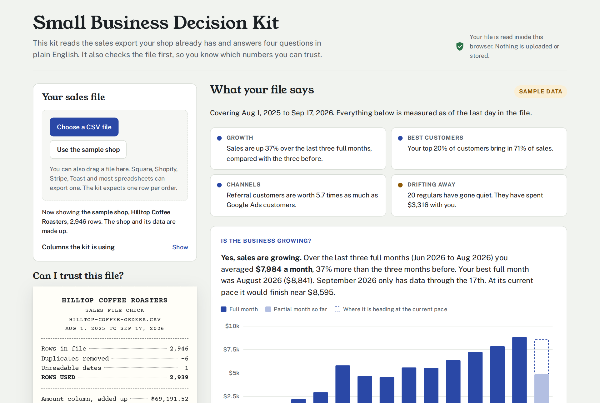

# Small Business Decision Kit

A free tool that turns a small business's sales export into four plain-English answers. It checks the file before it trusts it, and nothing ever leaves your computer.

**Try it:** https://chikeokwudiafor.github.io/smallbiz-decision-kit/

## What it answers

| Question | What you get |
| :- | :- |
| Is the business growing? | Net sales by month, the last three full months compared with the three before, and where an unfinished month is heading at its current pace. |
| Who are my best customers? | How much of your sales comes from your top 20% of customers, plus your ten biggest customers. |
| Where do my best customers come from? | Average spend and repeat rate for each channel (walk-in, Instagram, referral and so on), based on where each customer placed their first order. |
| Who is drifting away? | Regular customers who have gone quiet compared with their own usual rhythm, sorted by how much they have spent. The list copies straight into a spreadsheet. |

It also writes a prompt you can paste into Claude, ChatGPT, Gemini or any AI chat. The prompt holds totals and averages only, and it tells the AI to use only those numbers.

## Why I built it

Most small businesses already have the data to answer these questions. It sits in a sales export from Square, Shopify, Stripe, Toast or a spreadsheet. What they usually lack is a data person, the time, and a way to know whether the numbers are right.

I have worked as a data analyst for more than five years, four of them at a large software company. The lesson I keep relearning is that a confident answer from a messy file is worse than no answer. An export that ran twice doubles a week of sales. A refund recorded as a sale makes a bad month look good. A month that is only half over looks like a collapse. So the kit checks the file first and shows its work, the way I would check a report before handing it to an executive.

The AI prompt exists for the same reason. Many owners now paste their sales files straight into an AI chat. That shares customer details they may not mean to share, and the AI can quietly invent numbers. The kit gives the AI a summary with no customer information in it and asks it to stick to the facts.

## How to use it

1. You export your sales as a CSV file (a comma-separated values file). Most point-of-sale and online store systems have an export option on their orders, transactions or payments page. Any spreadsheet can also save a sheet as CSV.
2. You open the kit. That can be the hosted page, or `index.html` from this folder opened in Chrome, Edge, Firefox or Safari. No install is needed.
3. You choose your file or drag it onto the page. The kit guesses which columns hold the date, amount, customer, channel and order number. If a guess is wrong, you change it under **Columns the kit is using** and every answer updates.

The page opens with a made-up coffee shop already loaded, so you can see what the answers look like before using your own file.

### What your file needs

| Column | Needed? | Examples of names the kit recognizes |
| :- | :- | :- |
| Order date | Yes | `order date`, `date`, `created at`, `transaction date` |
| Amount | Yes | `amount`, `total`, `net sales`, `order total` |
| Customer | For the customer answers | `customer id`, `customer`, `email`, `client` |
| Where the customer came from | For the channel answer | `channel`, `source`, `referral source`, `utm source` |
| Order number | Optional, improves the checks | `order id`, `order number`, `transaction id`, `receipt` |

The kit expects one row per order. Dates can be written as `2026-09-17`, `9/17/2026`, `17/09/2026` or `Sep 17, 2026`. Amounts can include dollar signs, commas, a minus sign or parentheses for refunds.

## The file check

Before answering anything, the kit prints a receipt that reconciles the file. It starts from the amount column added up as-is, subtracts each problem it found, and ends at the net sales it will actually use. Every number on the page traces back to that receipt.

| Check | What the kit does |
| :- | :- |
| Duplicate rows | Rows identical in every column are counted once. The receipt shows how much money the extra copies would have added. |
| Unreadable dates | Rows with a date that cannot exist (like `13/45/2026`) are set aside, listed with their order number, and shown on the receipt. |
| Unreadable amounts | Rows whose amount is not a number are set aside and listed. |
| Refunds | Negative amounts are subtracted from sales and never counted as orders. |
| Orders with no customer | Kept in sales totals, left out of customer answers, and counted so you know how many. |
| Partial months | A first or last month that is not complete is shown separately and left out of comparisons, so it never looks like a drop. |
| Repeated order numbers | Flagged. If many repeat, the kit warns that the file may list items instead of orders. |
| Date style | Day-first and month-first dates are detected from the file. When every date is ambiguous, the kit says so and lets you switch. |

## How the answers are calculated

These are simple, visible rules rather than a hidden model. I would rather an owner understand the rule than trust a black box.

- **Net sales** are all readable, non-duplicate rows added together, refunds included.
- **Orders** are rows with an amount above zero.
- **Growth** compares the average of the last three full months with the three full months before them. With fewer than six full months, it compares the last two full months.
- **Pace** for an unfinished month is its sales so far, divided by the days covered, times the days in that month.
- **Top 20%** ranks customers by net spend. The share counts only sales that have a customer attached.
- **Channels** group each customer by the channel on their first order. Only customers whose first order came at least 90 days before the file ends are counted, so brand-new customers do not drag the averages down.
- **Drifting away** covers customers with orders on at least three different days. Each person's usual gap is the median time between their orders. They are listed when the time since their last order is more than double that gap, at least 30 days, and under six months. Customers quiet for longer than six months are counted separately.

Everything is measured as of the last day in the file, not today's date. That keeps the answers the same no matter when you open the file.

## Privacy

- The file is read by your own browser. There is no server, no account, no tracking and no cookies.
- The page asks Google Fonts for its typefaces. Only the font request goes out, never your data. With no internet connection, the page falls back to your computer's own fonts and works the same.
- The AI prompt includes monthly totals, counts, percentages and channel averages. It never includes customer IDs, names, emails or any single order.

## Hosting your own copy

The whole tool is the single file `index.html`. It can be emailed, put on a USB drive, or hosted anywhere that serves static pages. On GitHub, **Settings**, then **Pages**, then **Deploy from a branch** (branch `main`, folder `/ (root)`) publishes it at `https://<your-username>.github.io/smallbiz-decision-kit/`.

## Working on the code

| Path | What it is |
| :- | :- |
| `index.html` | The finished tool. This is the only file a user needs. |
| `src/template.html` | The source of the page, without the sample data. |
| `sample-data/hilltop-coffee-orders.csv` | The made-up sample file. |
| `tools/build.py` | Rebuilds `index.html` from the template and the sample data. |
| `tools/generate_sample.py` | Regenerates the sample file. The random seed is fixed, so it always produces the same file. |

After changing the template or the sample, `python3 tools/build.py` rebuilds the page. The kit uses no libraries and no build tools beyond that script.

In my own testing, the numbers on the page match an independent Python calculation to the cent. A 200,000-row file (about 9 MB) loads in about one second in Chrome.

## The sample shop

Hilltop Coffee Roasters is made up, and so is every customer in it. The file covers August 1, 2025 to September 17, 2026, with 2,946 rows. Problems are planted on purpose, the way real exports go wrong: six rows exported twice, one date that cannot exist, three refunds, four orders with no customer ID, and a last month that stops on the 17th.

## Limits

- The kit reads CSV files only. An Excel or Numbers file needs to be saved as CSV first.
- It expects one row per order. An export that lists every item in an order will overcount orders, and the kit warns when it sees that pattern.
- Amounts are shown with a dollar sign. Other currencies still add up correctly.
- The channel answer is only as good as the channel column in your file.
- The drifting-away list uses a rule of thumb, not a prediction. It tells you who to look at, not who will leave.

## License and citation

The kit is free and open source under the [MIT License](LICENSE). If you use it in research or teaching, [CITATION.cff](CITATION.cff) has the citation details.

## About me

I am Chike Okwudiafor, a data analyst and analytics engineer in Pittsburgh. I build tools that help people make decisions with data they already have, and I care most about whether the numbers can be trusted. The companion project, the [Data Trust Playbook](https://github.com/chikeokwudiafor/data-trust-playbook), explains the reconciliation method behind the file check.

[LinkedIn](https://www.linkedin.com/in/chike-okwudiafor/)
